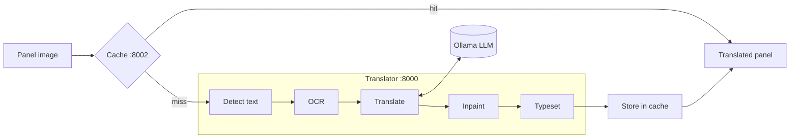

# mt-stack

Translate Korean manhwa and Japanese manga into English on the page you are reading. One button in Chrome. Everything runs on your Mac and nothing is uploaded.


A Chrome extension grabs each panel. A local pipeline finds the text, reads it, translates it with a local LLM, paints over the original and sets the English in its place. The extension swaps the new image into the page, and repeat visits come from a cache.

This repo is the glue around [manga-image-translator](https://github.com/zyddnys/manga-image-translator) and [Ollama](https://ollama.com): the caching proxy, the extension, service management, a tuned prompt and an installer. It ships no manga and no model weights.



## Quick start

Needs macOS (launchd and zsh), Chrome, [Ollama](https://ollama.com), and a working manga-image-translator checkout with its venv. The checkout is expected at `~/manga-image-translator`. Set `MT_HOME` if it lives elsewhere.

```sh
git clone https://github.com/lucas-low/manhwa-translator.git && cd manhwa-translator
./install.sh
ollama pull aya-expanse:32b
mt-start
```

Then load the extension once: `chrome://extensions`, turn on Developer mode, Load unpacked, pick the `extension/` folder. Open a chapter and click **Translate Chapter**.

`install.sh` writes three plists to `~/Library/LaunchAgents`, copies the prompt to `~/.config/mt-stack/gpt_config.yaml` if it is not there yet, and symlinks the four commands into `~/bin` (put that on your `PATH`). It never touches the `.env` of manga-image-translator.

## Measured

On an M2 Max with 64 GB, using `aya-expanse:32b` through Ollama (about 21 GB resident).

| | Time |
|---|---|
| Cold chapter, 70 panels | about 3 min |
| Same chapter again, from cache | 5 to 10 s |
| One panel, miss | about 11 s |
| One panel, hit | under 0.5 s |

These are the author's own runs, logged per panel to `metrics.jsonl` and summarised at `/stats`.

## How a panel travels

1. The extension fetches the image bytes through `chrome.debugger` (`Network.loadNetworkResource`), because the image CDNs block fetches from the page itself. It keeps 5 panels in flight and offers **Retry Failed** for the rest.
2. It posts the bytes to `POST /translate-cached` on the proxy.
3. The proxy hashes the bytes plus the request config with SHA-256. A hit returns the stored PNG. A miss goes to the translator, and the result is stored.
4. When the cache passes `MT_CACHE_MAX_GB` the oldest entries are evicted until it is back to 90% of the cap.

Every response carries `X-MT-Cache` (`hit` or `miss`), `X-MT-Translator`, `X-MT-Tried` and, on failure, `X-MT-Error`.

> [!WARNING]
> The cache key covers the image and the request config. It does not cover which Ollama model is loaded or what is inside `gpt_config.yaml`. After you change either one, clear the cache: `curl -X POST http://127.0.0.1:8002/cache/clear`

## Use it

**In the browser.** Click the button on a chapter page. The pill shows progress and failed panels can be retried.

**From a saved page.** Save the chapter with ⌘S as "Webpage, Complete", then translate the folder. The result lands in `<folder>_translated` next to it and `viewer.html` opens when it finishes.

```sh
mt-translate ~/Downloads/chapter22_files
```

**Dashboard.** `http://127.0.0.1:8002` takes a dropped folder and shows progress.

| Command | What it does |
|---|---|
| `mt-start` | Loads the services, waits for ports 8000 and 8002, warms the model |
| `mt-stop` | Unloads the services and asks Ollama to free the model (about 22 GB) |
| `mt-status` | Services, ports, health, loaded models and cache size |
| `mt-translate <folder or .html>` | Batch-translates a saved chapter |

| Proxy endpoint (`:8002`) | Purpose |
|---|---|
| `POST /translate-cached` | Translate one image, with caching |
| `GET /stats` | Hits, misses, failures and average miss time from `metrics.jsonl` |
| `GET /cache/stats` | File count and size of the cache |
| `POST /cache/clear` | Delete every cached panel |
| `POST /cache/evict` | Run LRU eviction now |
| `GET /`, `POST /start`, `GET /progress/{job}`, `GET /result/{job}/{file}` | The drag-a-folder dashboard |

## Configuration

| Variable | Default | Used by |
|---|---|---|
| `MT_HOME` | `~/manga-image-translator` | `install.sh`, `mt-translate` |
| `MT_OUT_ROOT` | `~/Downloads/mt-ui-out` | proxy: `cache/` and `metrics.jsonl` |
| `MT_CACHE_MAX_GB` | `10` | proxy |
| `MT_GPT_CONFIG` | `~/.config/mt-stack/gpt_config.yaml` | proxy, warmup, `mt-translate` |

The model and endpoint are set in the `.env` of manga-image-translator. [`.env.example`](.env.example) shows the values for local Ollama, and no real API key is needed.

## Layout

```
extension/            Chrome MV3 extension: button, auto-scroll, retry
server/mt_ui.py       cache proxy and dashboard on :8002
server/mt_warmup.py   loads the models once at login
config/               gpt_config.yaml, the translation prompt
scripts/              mt-start, mt-stop, mt-status, mt-translate
launchd/              service templates that install.sh renders
tests/                unittest suite
```

## Develop

```sh
~/manga-image-translator/venv/bin/python -m unittest discover -s tests -v
```

The suite covers the cache key, LRU eviction and path handling. It also fails if a hardcoded home directory or a key-shaped string shows up anywhere in the repo. Logs are at `/tmp/mt-ui.log` and `/tmp/mt-translator.log`. Working on this with a coding agent? Start with [AGENTS.md](AGENTS.md).

## Limits

- One machine, one user. Services bind to `127.0.0.1` and have no auth.
- Chrome shows a "being debugged" bar while a chapter translates, because of the `chrome.debugger` route.
- OCR is tuned for Korean, Japanese and English. Other scripts work with lower accuracy.
- Quality is whatever the local model gives you. Expect wrong names and tone slips now and then.
- Use it on content you have the right to read. It is a reading aid and not a way to redistribute translations.

## History

The first working version was written on 25 and 26 May 2026 and has run as launchd services on the author's machine since. The May commits here are reconstructed from the original files' modification times. The repo was created and packaged in November 2026.

MIT licensed. See [LICENSE](LICENSE).
